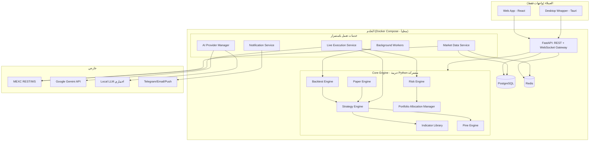
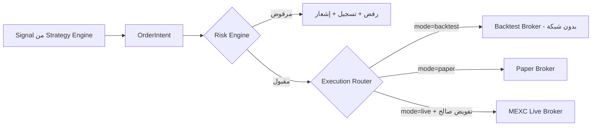
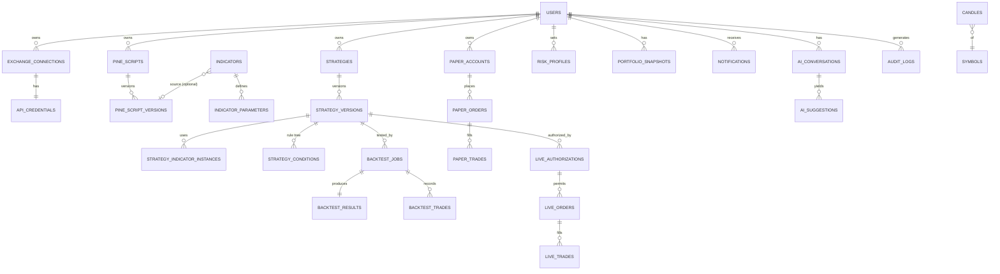
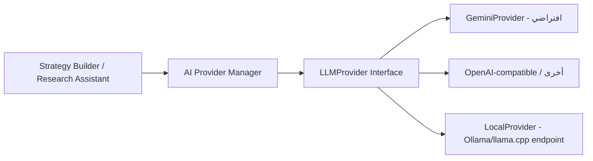

# APEX AI Trading Lab — وثيقة المرحلة صفر: التصميم الهندسي والتخطيط التقني

**الإصدار:** 1.0 (القرارات المعمارية معتمدة من المالك)
**الحالة:** بانتظار إذن البدء الصريح للمرحلة 1
**نطاق الوثيقة:** تصميم فقط. لا يوجد كود تطبيق في هذه المرحلة.

> **ملاحظة الصدق الهندسي:** أي معلومة عن واجهة MEXC (نقاط النهاية، أنواع الأوامر، حدود الطلبات، فواصل الشموع) مكتوبة هنا من المعرفة العامة، وهي **غير مُتحقَّق منها** وسيتم التحقق منها من التوثيق الرسمي الحالي في المرحلة 3 قبل اعتماد أي شيء. أي عنصر موسوم بـ `⚠️ يتطلب تحققاً` لا يجوز البناء عليه قبل التحقق.

---

## 0. القرارات المعتمدة من المالك

| # | القرار | القيمة المعتمدة |
|---|--------|-----------------|
| 1 | نموذج المستخدمين | مستخدم واحد (المالك فقط) |
| 2 | بيئة التشغيل الأولية | جهاز المالك المحلي (Windows) |
| 3 | مزود الذكاء الاصطناعي الافتراضي | Google (Gemini)، قابل للتغيير عبر طبقة تجريد |
| 4 | صيغة الوثائق | Markdown ضمن مستودع Git |
| 5 | ترتيب المراحل | المعدّل (13.1): الاختبار الخلفي وReplay قبل Pine والذكاء الاصطناعي |
| 6 | المهام الخلفية | ARQ (مع واجهة تجريد تسمح بالانتقال إلى Celery) |
| 7 | غلاف سطح المكتب | Tauri |
| 8 | مترجم Pine | بناء المحلل بأنفسنا، بدون تقييم `pynescript` |
| 9 | Stop Loss / Take Profit | من جهة المنصة إن لم يدعمهما MEXC أصلياً، مع تحذير الاعتماد على تشغيل الجهاز |
| 10 | بعد إقلاع غير نظيف | الاستراتيجيات الحية تبدأ موقوفة وتنتظر تأكيدك بعد تقرير المطابقة |
| 11 | البيانات الأولية | BTC/USDT وETH/USDT، سنتان من التاريخ |
| 12 | لغة الواجهة | الإنجليزية افتراضياً، قابلة للتبديل إلى العربية (RTL) |

**أثر القرارات على التصميم:**
- مستخدم واحد ⇒ نبسّط الصلاحيات (بدون RBAC معقد)، لكن نحتفظ بعمود `owner_id` في الجداول الأساسية كي لا تتطلب ترقية مستقبلية إعادة بناء قاعدة البيانات. المصادقة تبقى إلزامية (كلمة مرور قوية + TOTP) لأن النظام يملك صلاحية تداول بأموال حقيقية.
- تشغيل محلي ⇒ كل الخدمات تعمل داخل Docker Compose على Windows (عبر WSL2). الخادم يستمع على `127.0.0.1` فقط افتراضياً، ولا يُعرَّض للإنترنت إلا بقرار صريح لاحق.
- قيد مهم للتشغيل المحلي: **التداول الآلي يتوقف إذا أُغلق الجهاز أو دخل وضع السكون.** يجب توثيق ذلك للمالك، وتصميم استعادة الحالة عند الإقلاع (انظر القسم 5.6). النقل لاحقاً إلى VPS يجب أن يتطلب تغيير إعدادات فقط وليس تغيير كود.

---

## 1. تحليل المواصفات وتقييم الجدوى

### 1.1 التقدير الصريح للحجم
المواصفات تشمل منصة تشبه TradingView + محرك اختبار خلفي + مترجم Pine Script + منفذ تداول آلي + مساعد ذكاء اصطناعي. هذا بحجم مشروع فريق لعدة أشهر. لذلك نعتمد **منهج MVP تدريجي** مع بوابات قبول صارمة.

### 1.2 الاعتماديات التقنية الرئيسية

```
بيانات MEXC ──► مخزن الشموع ──► مكتبة المؤشرات ──► محرك الاستراتيجيات ──► الاختبار الخلفي
                                      ▲                     ▲                    │
                                 Pine Engine ───────────────┘                    ▼
                                                                          Paper Trading
                                                                                │
                                                          Risk Engine ◄─────────┘
                                                                │
                                                          Live Execution ──► MEXC
```

**نتيجة:** لا يمكن بناء Pine Script أو الاختبار قبل وجود بيانات موثوقة ومكتبة مؤشرات صحيحة. ولا يجوز بناء التداول الحي قبل Risk Engine وPaper Trading.

### 1.3 تقييم المخاطر الأعلى (ملخص — التفصيل في القسم 12)
1. **Pine Script Engine:** أخطر جزء تقنياً. التوافق الكامل غير واقعي؛ نبني مجموعة فرعية موثقة.
2. **التداول الحي:** أخطر جزء مالياً. يأتي أخيراً وبعد فترة طويلة من Paper Trading.
3. **دقة المؤشرات:** يجب أن تطابق TradingView ضمن هامش محدد؛ فروقات البيانات والحدود الزمنية متوقعة.

---

## 2. تقييم حزمة التقنيات المقترحة

| الطبقة | المقترح | التقييم | القرار الموصى به |
|--------|---------|---------|------------------|
| واجهة أمامية | React + TS + Vite + Tailwind | ممتاز، ناضج | **اعتماد** |
| الرسم | TradingView Lightweight Charts | ممتاز للشموع والمؤشرات؛ **أدوات الرسم (فيبوناتشي، مستطيل…) غير مدمجة** وتحتاج تنفيذاً مخصصاً عبر Primitives/Plugins | اعتماد + تنفيذ أدوات الرسم تدريجياً (مخاطرة متوسطة) |
| محرر الكود | Monaco | ممتاز، مع تعريف لغة Pine مخصص | **اعتماد** |
| حالة الواجهة | Zustand + TanStack Query | خفيف ومناسب | **اعتماد** |
| خلفية | Python + FastAPI | مناسب (نظام المؤشرات والتحليل في Python) | **اعتماد** |
| قاعدة البيانات | PostgreSQL | مناسب. للشموع بكثافة عالية يُنصح بالتقسيم (Partitioning) أو TimescaleDB | PostgreSQL + تقسيم؛ تقييم TimescaleDB في المرحلة 2 |
| ذاكرة مؤقتة/رسائل | Redis | مناسب (Pub/Sub، أقفال، قوائم) | **اعتماد** |
| المهام الخلفية | Celery | **Celery لا يدعم Windows رسمياً.** يعمل داخل حاويات Linux عبر Docker، لذلك مقبول. بدائل أخف: ARQ أو Dramatiq | **قرار مطلوب** (انظر 2.1) |
| سطح المكتب | Tauri أو Electron | Tauri أخف وأكثر أماناً (Rust)؛ Electron أنضج وأسهل | **قرار مطلوب** (انظر 2.2) |
| الاختبار الخلفي | Python vectorized + event-driven | نهج مزدوج صحيح: Vectorized للمسح السريع، Event-driven للدقة والـ Replay | **اعتماد** |
| معالجة البيانات | NumPy + pandas (+ Numba عند الحاجة) | قياسي | **اعتماد** |

### 2.1 قرار: نظام المهام الخلفية
- **الخيار أ (موصى به):** Celery داخل Docker + Redis. نضج عالٍ، مراقبة جيدة (Flower)، يعمل لأن الحاويات Linux.
- **الخيار ب:** ARQ (async أصلي، أخف، يتكامل مع asyncio الذي يعتمده محرك التداول).
- **توصيتي:** ابدأ بـ **ARQ** لتقليل التعقيد في مشروع بمستخدم واحد، واحتفظ بواجهة تجريد للمهام تسمح بالتبديل إلى Celery لاحقاً. محرك التداول الحي نفسه **لا يعمل كمهمة Celery** بل كخدمة دائمة مستقلة (انظر 5).

### 2.2 قرار: غلاف سطح المكتب
- **Tauri (موصى به):** حجم صغير، استهلاك ذاكرة أقل، نموذج أمان أقوى. التكلفة: يحتاج Rust لجزء الغلاف (صغير).
- **Electron:** يعتمد JavaScript فقط، لكن أثقل.
- **ملاحظة معمارية حاسمة:** التطبيق المكتبي **غلاف للواجهة نفسها** يتصل بنفس الـ Backend. المراقبة والتنفيذ في الخلفية تعمل في **خدمة Backend**، وليس داخل التطبيق المكتبي. لذلك "عدم الاعتماد على متصفح" يتحقق لأن الخدمة تعمل مستقلة، والتطبيق المكتبي يضيف الإشعارات وأيقونة الشريط وتشغيل/إيقاف الخدمة.

### 2.3 قرار: مترجم Pine Script
- **الخيار أ:** بناء Parser يدوي أو بـ Lark/ANTLR. تحكم كامل، جهد كبير (Pine تعتمد المسافات البادئة).
- **الخيار ب:** تقييم مكتبة `pynescript` (تحليل Pine إلى AST بـ Python) كأساس للـ Parser، مع بناء طبقة التنفيذ الخاصة بنا. **⚠️ يتطلب تحققاً** من حالة المكتبة ورخصتها ودعمها للإصدار 6 قبل الاعتماد.
- **القرار المعتمد:** الخيار أ، بناء المحلل بأنفسنا دون تقييم `pynescript`.
- **التنفيذ:** مفسّر شجرة (Tree-walking interpreter) فوق سلاسل NumPy، **بدون** `eval`/`exec` إطلاقاً، مع حدود زمن/ذاكرة (انظر 7.5).

---

## 3. معمارية النظام (System Architecture)

### 3.1 المبدأ الحاكم
**نواة واحدة مشتركة (Core Engine) + Backend موحد.** الويب وسطح المكتب واجهتان لنفس الخدمات. لا منطق تداول في أي واجهة.

### 3.2 مخطط المكونات



### 3.3 مبدأ الفصل الصارم بين المحاكاة والتنفيذ الحقيقي

هذا قيد أمان حاسم، ويُفرض **بنيوياً** وليس بالاتفاق فقط:



**ضمانات بنيوية:**
1. واجهة `Broker` مجردة بثلاثة تنفيذات: `BacktestBroker`, `PaperBroker`, `MexcLiveBroker`.
2. فقط `MexcLiveBroker` يستورد عميل MEXC الموقّع (بيانات الاعتماد). حزم الاختبار والـ Paper **لا تملك اعتماداً (dependency)** على هذا العميل، ويتحقق من ذلك اختبار تحليل استيراد في CI.
3. `MexcLiveBroker` يرفض أي `OrderIntent` لا يحمل `risk_approval_token` صادراً من Risk Engine و`live_authorization_id` صالحاً.
4. الذكاء الاصطناعي **لا يستورد** أي Broker. يتعامل فقط مع واجهة قراءة/اقتراح.

### 3.4 قنوات الاتصال
- **واجهة ↔ خادم:** REST للعمليات، WebSocket واحد مُعدَّد (multiplexed) للبث: أسعار، إشارات، حالة الأوامر، إشعارات.
- **داخل الخادم:** Redis Pub/Sub لأحداث السوق والإشارات، وPostgreSQL كمصدر الحقيقة للحالة.
- **محرك التداول الحي:** خدمة منفصلة (عملية مستقلة) تستهلك أحداث الشموع المغلقة من Redis وتكتب الأوامر في قاعدة البيانات **قبل** إرسالها (انظر 5.4).

---

## 4. معمارية قاعدة البيانات (ERD)

### 4.1 المبادئ
- PostgreSQL، هجرات عبر Alembic، مفاتيح أجنبية صارمة.
- فصل جداول **التنفيذ الحي** عن **المحاكاة** عبر جداول مستقلة (لا عمود `is_simulated` في جدول مشترك) لمنع الخلط بنيوياً.
- كل الأوقات `timestamptz` بـ UTC.
- الشموع في جدول مقسَّم (Partition) حسب (الرمز) أو الزمن؛ لا تُخزَّن كتلاً ضخمة في حقل واحد.
- المبالغ بـ `NUMERIC` وليس `float`.
- الأسرار مشفرة على مستوى التطبيق (AES-256-GCM) بمفتاح رئيسي خارج قاعدة البيانات.

### 4.2 مخطط الكيانات



### 4.3 الجداول الأساسية (الأعمدة الجوهرية)

| الجدول | أعمدة جوهرية | ملاحظات |
|--------|--------------|---------|
| `symbols` | id, exchange, symbol, base, quote, price_precision, qty_precision, min_qty, min_notional, status, updated_at | قواعد الأوامر تُحدَّث من MEXC |
| `candles` | symbol_id, timeframe, open_time (UTC), o, h, l, c, volume, is_closed, source | PK مركب (symbol_id, timeframe, open_time)، تقسيم + فهرس زمني |
| `candle_coverage` | symbol_id, timeframe, from_ts, to_ts, validated_at, gap_count | يسجّل ما تم تنزيله وفحصه |
| `pine_scripts` / `pine_script_versions` | script_id, version, source_code, pine_version, script_type, ast_json, compat_report, sha256 | الأصل لا يُعدَّل أبداً |
| `indicators` | id, name, category, kind (builtin/pine), current_version | |
| `indicator_parameters` | indicator_id, name, type, default, min, max | تُولَّد منها واجهة الإعدادات |
| `strategies` | id, name, status, current_version_id | |
| `strategy_versions` | id, strategy_id, version_no, definition_json, definition_hash, created_at, change_note | **غير قابل للتعديل (immutable)** |
| `strategy_indicator_instances` | version_id, instance_key, indicator_id, params_json, timeframe, weight, enabled | |
| `strategy_conditions` | version_id, node_id, parent_id, node_type (AND/OR/NOT/COMPARE/CROSS…), operands_json, role (entry/exit) | شجرة قواعد |
| `backtest_jobs` | id, strategy_version_id, config_json, data_snapshot_hash, status, started/finished | الربط بإصدار محدد + لقطة بيانات = قابلية إعادة الإنتاج |
| `backtest_results` / `backtest_trades` | المقاييس المحسوبة + قائمة الصفقات | تُحسب فعلياً فقط |
| `paper_*` | حسابات/أوامر/صفقات افتراضية | معزولة تماماً |
| `live_authorizations` | id, strategy_version_id, capital_mode, capital_value, risk_profile_id, granted_at, revoked_at, scope | **لا تداول حي بدونها** |
| `live_orders` | id, client_order_id (UNIQUE), exchange_order_id, symbol_id, side, type, qty, price, status, risk_approval_token, created_at | **تُكتب قبل الإرسال** |
| `live_trades` | order_id, exchange_trade_id (UNIQUE), price, qty, fee, fee_asset, ts | |
| `risk_profiles` | حدود الخسارة اليومية/الأسبوعية/السحب/التعرض/التبريد | |
| `audit_logs` | ts, actor, action, entity, payload_redacted, hash_prev | سجل ملحق فقط (append-only) مع تسلسل تجزئة |
| `ai_conversations` / `ai_suggestions` | + status (pending/approved/rejected) | الاقتراح لا يُطبَّق إلا بعد الموافقة |

### 4.4 سياسات
- **الاحتفاظ:** الشموع دائمة (قابلة للإعادة التنزيل)، سجلات التدقيق والأوامر الحية دائمة، نتائج الاختبار الخلفي القديمة قابلة للأرشفة، لقطات المحفظة تُضغط (يومي بعد 90 يوماً).
- **النسخ الاحتياطي:** `pg_dump` مجدول يومياً، مشفر، مع اختبار استعادة دوري. (التفصيل في 10.)

---

## 5. معمارية محرك التداول (Trading Engine)

### 5.1 الوحدات
`MarketDataService` → `StrategyRunner` → `RiskEngine` → `PortfolioAllocationManager` → `ExecutionRouter` → `Broker`.

### 5.2 دورة الإشارة
1. تصل شمعة **مغلقة** (وضع Closed Candle هو الافتراضي والموصى به).
2. `StrategyRunner` يحسب المؤشرات باستخدام بيانات متاحة حتى تلك اللحظة فقط.
3. تُولَّد `Signal` ثم `OrderIntent` (رمز، جهة، كمية مقترحة، SL/TP، سبب الإشارة).
4. `RiskEngine` يتحقق (انظر 5.5)، ثم `PAM` يحجز رأس المال.
5. `ExecutionRouter` يوجه حسب الوضع.

### 5.3 منع الخلل الزمني (Look-ahead)
- كل مؤشر متعدد الأطر الزمنية يُحسب من شموع الإطار الأعلى **المغلقة فقط** عند لحظة الإشارة.
- اختبار آلي إلزامي: تشغيل الاستراتيجية على بيانات مقتطعة عند الشمعة N يجب أن يعطي نفس إشارة الشمعة N عند التشغيل على البيانات الكاملة (اختبار "عدم تسرب المستقبل").

### 5.4 منع تكرار الأوامر (Idempotency)
- `client_order_id` يُشتق حتمياً من (strategy_version_id, symbol, candle_open_time, signal_type) ⇒ نفس الإشارة تنتج نفس المعرف دائماً.
- قيد `UNIQUE(client_order_id)` في قاعدة البيانات.
- **كتابة الأمر في قاعدة البيانات بحالة `PENDING_SUBMIT` قبل الإرسال**، ثم الإرسال، ثم التحديث. إن انقطع الاتصال بعد الإرسال وقبل التحديث، تتولى المطابقة (5.6) الحسم.
- قفل Redis موزّع لكل (استراتيجية، رمز) أثناء المعالجة.

### 5.5 Risk Engine (مستقل)
يتحقق قبل **كل** أمر حي من: أقصى مخاطرة للصفقة، الخسارة اليومية/الأسبوعية، السحب الأقصى، عدد المراكز، التعرض لكل أصل، التبريد بعد الخسائر المتتالية، الرصيد الكافي، الحد الأدنى للأمر والدقة، حالة Emergency Stop. ينتج `risk_approval_token` قصير الصلاحية ومربوطاً بالأمر. **لا يمكن للذكاء الاصطناعي تعديل هذه الحدود.**

### 5.6 المطابقة والاستعادة (Reconciliation)
عند الإقلاع أو بعد انقطاع:
1. تحميل الحالة المحفوظة من PostgreSQL.
2. جلب الأوامر المفتوحة والأرصدة وآخر الصفقات من MEXC.
3. مطابقة: أوامر `PENDING_SUBMIT` تُبحث بـ `client_order_id` على البورصة (إن وُجدت تُحدَّث، وإن لم توجد تُعلَّم كغير منفذة).
4. أي تضارب غير قابل للحل تلقائياً ⇒ **إيقاف الاستراتيجية المعنية + إشعار** وليس تخمين.
5. السلوك الافتراضي بعد إقلاع غير نظيف: **الاستراتيجيات الحية تبدأ في حالة موقوفة** وتتطلب تأكيداً يدوياً بعد عرض تقرير المطابقة.

### 5.7 Emergency Stop
زر واحد يقوم بـ: إيقاف كل StrategyRunners الحية، منع أي أوامر جديدة، إلغاء الأوامر المفتوحة، **ولا يغلق المراكز** إلا حسب سياسة أُعدَّت مسبقاً ووافق عليها المالك. تُسجَّل الحالة في قاعدة البيانات وتبقى بعد إعادة التشغيل.

---

## 6. معمارية Backtesting والإعادة التفاعلية

### 6.1 محركان بنفس منطق الإشارة
- **Vectorized:** للمسح السريع للمعاملات (Parameter Sensitivity، Walk-Forward).
- **Event-driven:** للدقة (رسوم، انزلاق، قيود الأوامر، SL/TP) وللـ Replay. **هو المرجع.**
- اختبار تكافؤ: على نفس البيانات يجب أن تتطابق إشارات المحركين.

### 6.2 افتراضات التنفيذ الموثقة
- الإشارة على إغلاق الشمعة N ⇒ التنفيذ عند **فتح الشمعة N+1** (افتراضي موثق).
- الرسوم والانزلاق من الإعدادات، والحد الأدنى للأمر والدقة من بيانات `symbols`.
- **تضارب SL وTP في نفس الشمعة:** استخدام شموع أدق (مثلاً 1m) إن توفرت، وإلا تطبيق **افتراض متحفظ ثابت** (يُحتسب الخسارة أولاً) ويُسجَّل في نتيجة الاختبار. لا يُختار الأكثر ربحاً أبداً.

### 6.3 مكافحة الإفراط في التهيئة (Overfitting)
In-Sample/Out-of-Sample، Walk-Forward، تحليل حساسية المعاملات، وتحذيرات تلقائية عند أداء ممتاز في العينة وضعيف خارجها.

### 6.4 Replay
- الخادم يبث الشموع **شمعة شمعة** من نقطة البداية؛ **لا يرسل شموعاً مستقبلية للواجهة أصلاً** (الحماية من جهة الخادم وليس بإخفائها في الواجهة).
- حالة الجلسة (الرصيد، المراكز) تُحفظ فتدعم الإيقاف والاستئناف والتجارب المتعددة.

### 6.5 جودة البيانات
فحص: شموع مفقودة، مكررة، فجوات، أوقات خاطئة، شموع غير مكتملة. كل نتيجة اختبار تحمل `data_snapshot_hash` وحالة جودة البيانات.

---

## 7. معمارية محرك Pine Script

### 7.1 المراحل
```
Source ─► Lexer/Indent ─► Parser ─► AST ─► Semantic Analyzer ─► Compat Report
                                                  │
                                                  ▼
                                    Interpreter (series-based, sandboxed)
```

### 7.2 التحليل عند الاستيراد
اكتشاف الإصدار (v5/v6) ونوع السكربت، استخراج `input.*`، المتغيرات، الدوال المدمجة، شروط `strategy.entry/exit`، `alertcondition`، استخدام `request.security`، الدوال غير المدعومة، ومؤشرات إعادة الرسم (repainting): `lookahead_on`، `barstate.*`، الاعتماد على الشمعة الحالية.

### 7.3 جدول الدعم (يُحدَّث مع كل مرحلة، ولا يُدَّعى شيء قبل اختباره)

| الميزة | الحالة المستهدفة | الحالة الحالية |
|--------|------------------|----------------|
| Parsing v5 | مرحلة 6 | مخطط |
| `input.*` وتوليد الواجهة | مرحلة 6 | مخطط |
| `ta.*` (rsi, ema, sma, macd, atr, bb…) | مرحلة 6 | مخطط |
| شروط وحلقات ودوال مستخدم | مرحلة 6 | مخطط |
| `request.security` | مرحلة 6 (مع lookahead_off أولاً) | مخطط |
| `strategy.entry/exit` | مرحلة 6–9 | مخطط |
| المصفوفات | لاحقاً | مخطط |
| v6 | بعد استقرار v5 | مخطط |
| Libraries / Drawing objects (`line`, `label`, `box`) | غير مدعوم مبدئياً | غير مدعوم |

أي دالة غير مدعومة ⇒ **تُرفض بوضوح مع تقرير** بدل تشغيل جزئي صامت.

### 7.4 التحقق مقابل TradingView
- مجموعة اختبارات ذهبية: بيانات OHLCV ثابتة + مخرجات مصدَّرة يدوياً من TradingView لنفس المؤشر والمعاملات.
- مقارنة آلية بحدود تسامح عددية، وتوثيق أسباب الفروقات (مصدر البيانات، حدود الشموع، افتراضات التنفيذ).
- ⚠️ ملاحظة: بيانات MEXC على TradingView وبيانات API قد تختلف قليلاً؛ سنوثق ذلك ولا نخفيه.

### 7.5 العزل الأمني
- **لا `eval` ولا `exec` ولا استيراد ديناميكي.** التنفيذ بمفسّر يتعامل مع AST فقط، ومجموعة دوال بيضاء (allow-list).
- حدود: زمن تنفيذ، عدد تكرارات الحلقات، حجم الذاكرة، عمق الاستدعاء.
- التنفيذ في عملية عاملة منفصلة (Worker) بأقل الصلاحيات، بلا شبكة ولا وصول لنظام الملفات.

### 7.6 وضعا الإشارات
- **Closed Candle (افتراضي):** حسابات على شموع مكتملة فقط.
- **Intrabar:** يُسمح بالحساب أثناء تكوّن الشمعة؛ يُعرض تحذير واضح أن الإشارة قد تتغير أو تختفي قبل الإغلاق، ولا يُسمح به في التداول الحي إلا بتفعيل صريح مع تحذير.

---

## 8. معمارية تكامل الذكاء الاصطناعي



- واجهة `LLMProvider` (generate, generate_structured, stream, health_check). **لا يعتمد أي محرك تداول عليها.**
- **المزود الافتراضي:** Google Gemini عبر SDK الرسمي. ⚠️ أسماء النماذج وحدودها تتغير؛ تُحفظ كإعداد قابل للتعديل، لا ثوابت في الكود.
- **المخرجات المهيكلة:** الذكاء الاصطناعي يُنتج `StrategyDefinition` بصيغة JSON Schema مُتحقَّق منها (Pydantic). أي مخرج لا يطابق المخطط يُرفض ويُعاد الطلب.
- **حالة الاستراتيجية:** كل استراتيجية يولدها الذكاء الاصطناعي تبدأ `Draft` وغير موثوقة حتى تمر بالتحقق الفني (Validator حتمي، ليس نموذجاً لغوياً).
- **قيود صلاحيات الذكاء الاصطناعي:**
  - لا وصول لأي Broker.
  - لا تعديل لإعدادات المخاطر أو الاستراتيجيات الحية.
  - اقتراحاته تُحفظ بحالة `pending` وتُطبَّق فقط بعد موافقة صريحة من المالك.
- **الخصوصية:** عند استخدام مزود سحابي، يُرسَل فقط ما يلزم (نتائج، مقاييس، تعريفات). **لا تُرسل مفاتيح API أو أرصدة تفصيلية** ما لم يلزم، وتُنقَّح السجلات.
- مفتاح Google يُخزَّن مشفراً في الـ Backend ولا يظهر في الواجهة.
- تمييز واضح في الواجهة بين: بيانات سوق موثقة، نتائج تاريخية محسوبة، تفسير الذكاء الاصطناعي، إجراءات مقترحة.

---

## 9. خطة تكامل MEXC

### 9.1 النطاق
Spot فقط. لا Futures ولا Margin ولا رافعة. لا طلب صلاحية سحب إطلاقاً.

### 9.2 ما يجب التحقق منه في المرحلة 3 (⚠️)
| البند | السبب |
|-------|-------|
| نقاط النهاية الحالية (REST v3) والـ WebSocket وتنسيق الرسائل (قد يكون Protobuf) | تتغير بين الإصدارات |
| فواصل الشموع المدعومة أصلاً | غالباً أقل من 15 المطلوبة، فالباقي (3m, 2h, 6h, 8h, 12h, 3D…) سيُولَّد بالتجميع |
| أنواع الأوامر المتاحة لكل زوج (Market, Limit, Limit Maker, IOC, FOK) | قد لا يدعم Stop/TP أصلياً |
| قواعد الدقة والحد الأدنى للأمر والرسوم | لكل زوج |
| حدود معدل الطلبات (Rate Limits) | لتصميم `RateLimiter` |
| دعم IP Whitelisting للمفاتيح | للأمان |
| أي قيود على أزواج معينة عبر API | بعض الأزواج قد لا تتاح للتداول عبر API |

### 9.3 القرار الاحتياطي لـ Stop Loss / Take Profit
إن لم يدعمهما MEXC أصلياً لزوج ما، تُنفَّذ **من جهة منصتنا** (مراقبة السعر وإرسال أمر Market/Limit عند التحقق). هذا يعني أن حماية SL **تتوقف إذا توقف جهازك**؛ يجب أن يعرف المالك ذلك بوضوح، ونعرض تحذيراً في واجهة التداول الحي. القرار النهائي بعد التحقق.

### 9.4 هيكل الوحدة (Exchange Adapter)
`ExchangeAdapter` (مجرد) ← `MexcAdapter`: `MarketDataClient` (عام، بلا مفاتيح)، `TradingClient` (موقّع، معزول)، `WsManager` (إعادة اتصال بتراجع تصاعدي، إعادة الاشتراك، فحص التسلسل)، `RateLimiter` (دلو رموز)، `OrderRules` (تحقق الدقة والحد الأدنى).

### 9.5 تنزيل البيانات التاريخية
تنزيل مُقسَّم (Pagination) مع احترام الحدود، تخزين محلي، فحص جودة، وتتبّع التغطية في `candle_coverage`. تجميع الأطر الأعلى بحدود صحيحة (UTC؛ بداية الأسبوع والشهر موثقة).

---

## 10. معمارية الأمان

| المجال | التصميم |
|--------|---------|
| المصادقة | حساب المالك: كلمة مرور قوية (Argon2id) + TOTP إلزامي. جلسات بـ HttpOnly/SameSite cookie أو رموز قصيرة الأجل مع تجديد |
| أسرار البورصة والذكاء الاصطناعي | تشفير AES-256-GCM في الـ Backend؛ المفتاح الرئيسي من متغير بيئة/مخزن أسرار نظام التشغيل، **ليس في المستودع ولا في قاعدة البيانات** |
| الواجهة | لا تحتوي أي سر. الأسرار لا تُعاد للواجهة بعد الحفظ (تُعرض مقنّعة) |
| الشبكة المحلية | الخادم على `127.0.0.1`. لا تعريض للإنترنت دون قرار صريح (وعندها HTTPS + قيود) |
| Rate Limiting وحماية API | CORS مقيّد، حدود طلبات، تحقق مدخلات (Pydantic) |
| صلاحيات المفاتيح | قراءة + تداول فقط، **لا سحب**؛ توصية IP Whitelist؛ دعم تدوير المفاتيح |
| التدقيق | `audit_logs` ملحق فقط مع تسلسل تجزئة، يشمل كل تفويض وأمر وتغيير مخاطرة |
| السجلات | تنقيح تلقائي للأسرار (Redaction)، لا تُسجَّل المفاتيح كاملة أبداً |
| تفويض التداول الحي | كيان `live_authorizations` صريح بنطاق محدد، قابل للإلغاء، وتأكيد ثنائي الخطوة في الواجهة |
| سلسلة التوريد | تثبيت إصدارات الحزم (lockfiles)، فحص الثغرات (pip-audit, npm audit) |
| النسخ الاحتياطي | `pg_dump` مشفر، مفتاح منفصل، اختبار استعادة |
| Pine Sandbox | انظر 7.5 |

**نموذج التهديد المختصر (مستخدم واحد، محلي):** أبرز التهديدات: برمجيات خبيثة على الجهاز تسرق المفاتيح، حقن عبر سكربت Pine مستورد، تسرب المفاتيح في السجلات، أخطاء المنطق التي تضاعف الأوامر. التخفيف: تشفير، عزل، اختبارات Idempotency، حدود مخاطرة صارمة.

---

## 11. معمارية الواجهة الأمامية

- **التقنيات:** React + strict TypeScript + Vite + Tailwind + React Router + TanStack Query + Zustand + Lightweight Charts + Monaco.
- **الطبقات:** `ui/` (مكونات عامة)، `layouts/` (Shell: Sidebar/Header/Mobile Nav)، `pages/`، `features/` (chart, strategy, pine, backtest, replay, live, risk)، `services/api/` (عملاء مُصنَّفون الأنواع)، `stores/`، `types/` (مولَّدة من OpenAPI)، `i18n/` (ar/en + RTL)، `theme/` (tokens).
- **نظام التصميم:** ألوان وخطوط المواصفات (Graphite/Navy/Cyan/Emerald…، Inter + IBM Plex Sans Arabic، أرقام جدولية) كـ CSS variables؛ وضع داكن أساسي وفاتح اختياري؛ **استخدام الخصائص المنطقية (logical properties) لدعم RTL** منذ اليوم الأول.
- **التجاوب:** تخطيطات تكيفية للمكتب/اللوحي/الجوال (تنقل سفلي وأدراج للجوال)، ولا تمرير أفقي للصفحة.
- **وضع DEMO:** محوّلات وهمية (mock adapters) **موسومة بوضوح "DEMO DATA"** وتُفعَّل صراحة؛ لا تُعرض أبداً كبيانات حية، ولا نزيّف اتصالاً بالبورصة أو أوامر ناجحة.
- **تزامن الرسم والاستراتيجية:** الرسم يستهلك قيم المؤشرات من **نفس** مكتبة الحساب في الـ Backend عبر API؛ لا حسابات مستقلة في المتصفح.
- **ترتيب بناء الواجهة:** نظام التصميم → Shell → تنقل المكتب/الجوال → لوحة التحكم → المحطة الطرفية، ثم بقية الوحدات تتبع المراحل.

---

## 12. هيكل المجلدات المقترح (Monorepo)

```
apex-ai-trading-lab/
├─ docs/
│  ├─ PHASE0_ARCHITECTURE.md
│  ├─ PROJECT_STATUS.md
│  ├─ DECISIONS.md              # سجل القرارات المعمارية (ADR)
│  ├─ PINE_SUPPORT_MATRIX.md
│  └─ runbooks/
├─ backend/
│  ├─ app/
│  │  ├─ api/                  # FastAPI routers (REST + WS)
│  │  ├─ core/                 # الإعدادات، الأمان، التشفير
│  │  ├─ db/                   # النماذج، الجلسات
│  │  └─ services/
│  ├─ engine/                  # Core Engine (بدون اعتماد على FastAPI)
│  │  ├─ indicators/
│  │  ├─ strategy/             # StrategyDefinition, Validator, Runner
│  │  ├─ pine/                 # lexer, parser, ast, interpreter, compat
│  │  ├─ backtest/
│  │  ├─ paper/
│  │  ├─ risk/
│  │  ├─ portfolio/
│  │  └─ execution/            # Broker interface + Router
│  ├─ exchanges/
│  │  └─ mexc/                 # adapter معزول
│  ├─ ai/                      # provider manager + gemini + local
│  ├─ workers/
│  ├─ migrations/              # Alembic
│  └─ tests/ (unit, integration, e2e, golden/)
├─ frontend/
│  └─ src/ (ui, layouts, pages, features, services, stores, types, i18n, theme)
├─ desktop/                    # غلاف Tauri
├─ deploy/                     # docker-compose, nginx اختياري, سكربتات النسخ الاحتياطي
├─ .github/workflows/          # CI (أو ما يعادله محلياً)
└─ README.md
```

**قاعدة تبعية:** `engine/` لا يستورد `exchanges/mexc` إلا عبر `execution/live_broker`. اختبار تحليل الاستيراد يفرض ذلك.

---

## 13. خارطة الطريق والبوابات

تتبع الترتيب الذي حددته (المراحل 1–16)، مع **إعادة ترتيب مقترحة تحتاج موافقتك** لتسريع القيمة وتقليل المخاطر:

### 13.1 الترتيب المعتمد (مع ملاحظة: أرقام المراحل هنا هي المعتمدة وتحل محل ترقيم المواصفات الأصلية)
نقل **Backtesting Engine (المرحلة 9)** قبل **AI Strategy Builder (7)** وPine Studio (6)؛ لأن الاختبار الخلفي الحقيقي هو أساس كل ما بعده، ولأن Pine والذكاء الاصطناعي يحتاجان `StrategyDefinition` ومحرك تقييم موجودين. الترتيب المقترح:

| المرحلة | المحتوى | بوابة القبول (أمثلة) |
|---------|---------|----------------------|
| 1 | العمارة، نظام التصميم، Shell، تنقل مكتبي/جوال، i18n/RTL | كل المسارات تعمل؛ لا تمرير أفقي من 320px–2560px؛ لا أخطاء كونسول |
| 2 | قاعدة البيانات، المصادقة، البنية الخلفية، Docker Compose | هجرات تعمل؛ تسجيل دخول+TOTP؛ تشفير الأسرار مُختبَر |
| 3 | بيانات MEXC (REST+WS) + تخزين الشموع + فحص الجودة | بيانات حقيقية؛ اختبار فجوات؛ إعادة اتصال WS مُختبرة |
| 4 | محطة الرسم + مؤشرات مدمجة | شموع مطابقة لـ MEXC؛ مؤشرات مطابقة لقيم مرجعية |
| 5 | مكتبة المؤشرات وإعداداتها | حفظ/استعادة بعد إعادة التشغيل |
| **6** | **Strategy Engine + Composer (كان 8)** | AND/OR/NOT/متعدد الأطر؛ 6+ مؤشرات؛ اختبار عدم تسرب المستقبل |
| **7** | **Backtesting Engine (كان 9)** | رسوم/انزلاق/SL-TP متحفظ؛ تكافؤ المحركين؛ مقاييس مُتحقَّق منها |
| **8** | **Replay التفاعلي (كان 10)** | لا شموع مستقبلية من الخادم؛ إيقاف/استئناف |
| 9 | Pine Script Studio (كان 6) | اختبارات ذهبية مقابل TradingView؛ جدول دعم صادق |
| 10 | AI Strategy Builder (كان 7) | مخرجات مهيكلة مُتحقَّق منها؛ لا تفعيل تلقائي |
| 11 | Paper Trading | فصل كامل عن الحي؛ سجل كل معاملة |
| 12 | Risk Management + PAM | رفض الأوامر المخالفة للحدود؛ اختبارات حدود |
| 13 | Live Trading (MEXC) | Idempotency؛ مطابقة بعد الانقطاع؛ تفويض صريح؛ **اختبار برأس مال صغير جداً أولاً** |
| 14 | AI Research Assistant | اقتراحات `pending` فقط |
| 15 | تطبيق سطح المكتب | تشغيل مستقل؛ إشعارات؛ استعادة |
| 16 | اختبارات شاملة، أمان، تحسين الأداء، نشر | تقرير المعايير العشرين |

**بوابة إلزامية قبل المرحلة 13 (Live):** فترة Paper Trading قابلة للتهيئة ناجحة + اختبار خارج العينة + موافقة صريحة. ينصح بتجربة أولى برأس مال صغير لا يضر بك.

### 13.2 إيقاعات العمل لكل مرحلة
شرح ما سيُبنى ← تحديد الملفات ← التنفيذ ← تشغيل الاختبارات ← إصلاح الأخطاء ← التوثيق ← تسجيل القيود المعروفة ← نقطة استرجاع (Git tag) ← تحديث `PROJECT_STATUS.md`.

---

## 14. المخاطر التقنية والقيود

| # | الخطر | الأثر | التخفيف |
|---|-------|-------|---------|
| 1 | توافق Pine الكامل غير واقعي | توقعات خاطئة | مجموعة فرعية موثقة + رفض صريح للمجهول + جدول دعم |
| 2 | فروقات بيانات/شموع عن TradingView | نتائج لا تتطابق | اختبارات ذهبية + توثيق الفروقات |
| 3 | MEXC لا يدعم SL/TP أصلياً لبعض الأزواج | حماية تعتمد على جهازك | تنفيذ جهة المنصة + تحذير واضح |
| 4 | جهازك المحلي ينام/ينقطع | فقدان مراقبة وحماية | استعادة آمنة (موقوف افتراضياً)، تعطيل السكون، ونقل إلى VPS لاحقاً مُوصى به قبل التداول الحي الجاد |
| 5 | تكرار أوامر عند إعادة الاتصال | خسارة مالية | Idempotency + كتابة قبل الإرسال + مطابقة |
| 6 | تسرب المستقبل (Look-ahead) | نتائج اختبار مضللة | اختبار تسرب آلي + حساب من شموع مغلقة |
| 7 | الإفراط في التهيئة | استراتيجية تفشل حياً | Walk-Forward + OOS + تحذيرات |
| 8 | أدوات الرسم غير مدمجة في Lightweight Charts | جهد كبير | تنفيذ تدريجي عبر Primitives؛ ترتيب الأدوات حسب الأولوية |
| 9 | حدود معدل MEXC والـ WebSocket | حظر/فقدان بيانات | RateLimiter + تراجع + مصدر حقيقة للمطابقة |
| 10 | هلوسة الذكاء الاصطناعي | استراتيجيات خاطئة | مخرجات مهيكلة + Validator حتمي + موافقة بشرية |
| 11 | تسريب المفاتيح | فقدان أموال | تشفير، تنقيح سجلات، لا سحب، IP whitelist |
| 12 | حجم المشروع | تأخر/تعقيد | MVP تدريجي وبوابات قبول |
| 13 | رخصة/قيود استخدام بيانات TradingView | قانوني | نقارن بنتائج مصدّرة يدوياً من حسابك فقط، لا نسحب بيانات آلياً |
| 14 | عدم تطابق الأسعار الورقية مع الحقيقة (انزلاق/سيولة) | تفاؤل زائد | نموذج انزلاق محافظ + تحذيرات |

**تحذير صريح:** لا أي نظام آلي يضمن ربحاً. النتائج التاريخية لا تضمن المستقبل، والمنصة أداة بحث وتنفيذ وليست ضماناً.

---

## 15. استراتيجية الاختبار

| المستوى | الأدوات | النطاق |
|---------|---------|--------|
| وحدات | pytest، Vitest | المؤشرات، المنطق، المحاسبة، التشفير |
| تكامل | pytest + Postgres/Redis (Docker) | API، DB، Broker محاكى |
| E2E | Playwright | مسارات الواجهة الكاملة، التجاوب، RTL |
| ذهبية | بيانات ومخرجات مرجعية مخزنة | المؤشرات وPine مقابل TradingView |
| خصائص | Hypothesis | عدم تسرب المستقبل، تكافؤ المحركين، Idempotency |
| أمان | bandit, pip-audit, npm audit، فحص استيراد المعمارية | فصل Live/Sim، الأسرار |
| معمارية | اختبار تحليل الاستيراد | منع استيراد عميل MEXC خارج Live |
| تحمل | سكربتات | WS، انقطاعات، إعادة إقلاع |
| تداول حي | **حساب برأس مال صغير جداً** | بعد اجتياز كل ما سبق |

كل معيار من المعايير العشرين في المواصفات له اختبار أو عرض قابل للتحقق وسيُسجَّل في `PROJECT_STATUS.md`.

---

## 16. خطة النشر

### 16.1 المرحلة الأولى: محلي (قرارك)
- `docker compose up`: خدمات `postgres`, `redis`, `backend`, `worker`, `live-engine`, `frontend` على Windows (Docker Desktop + WSL2).
- كل المنافذ مربوطة بـ `127.0.0.1`.
- أسرار في ملف `.env` غير مُتتبَّع في Git (أو مخزن أسرار النظام).
- النسخ الاحتياطي: مهمة يومية `pg_dump` مشفرة إلى مجلد خارج المستودع، مع سكربت استعادة مُختبَر.
- **إعدادات Windows:** تعطيل السكون أثناء التداول الحي، وتشغيل Docker عند الإقلاع.

### 16.2 المرحلة اللاحقة: VPS (اختياري، مُوصى به للتداول الحي الجاد)
نفس ملفات Compose + Reverse Proxy بـ HTTPS + جدار ناري + IP ثابت لـ IP Whitelist. التحول يجب ألا يتطلب تغيير كود.

### 16.3 سطح المكتب
حزمة Tauri تتصل بالخادم (محلي أو بعيد) وتدير تشغيل/إيقاف الخدمة، وتعرض الإشعارات.

---

## 17. القرارات (تمت الإجابة عليها)

تم اعتماد جميع النقاط الثماني، وهي مدرجة في القسم 0 (البنود 5–12). الأسئلة الأصلية للمرجع:

1. **ترتيب المراحل:** هل توافق على الترتيب المعدَّل في 13.1 (الاختبار الخلفي قبل Pine والذكاء الاصطناعي)؟
2. **المهام الخلفية:** ARQ (موصى به) أم Celery؟ (2.1)
3. **سطح المكتب:** Tauri (موصى به) أم Electron؟ (2.2)
4. **Pine:** الموافقة على إجراء تقييم نموذجي لـ `pynescript` في بداية مرحلة Pine قبل الحسم؟ (2.3)
5. **SL/TP:** الموافقة المبدئية على التنفيذ من جهة المنصة إن لم يدعمهما MEXC أصلياً، مع تحذير الاعتماد على تشغيل الجهاز؟ (9.3)
6. **السلوك بعد إقلاع غير نظيف:** الاستراتيجيات الحية تبدأ موقوفة وتنتظر تأكيدك بعد تقرير المطابقة؟ (5.6)
7. **أولوية البيانات:** ما الأزواج والفترة الزمنية التي تريد البدء بها؟ (مثلاً BTC/USDT, ETH/USDT لمدة سنتين).
8. **اللغة الافتراضية للواجهة:** العربية (RTL) أم الإنجليزية؟

---

## 18. ما بعد الموافقة

بعد ردك، أحدّث هذه الوثيقة إلى الإصدار 1.0 (معتمد) وأبدأ **المرحلة 1** بإعلان مسبق عن الملفات التي ستُنشأ، دون أي ترقية للمراحل التالية قبل اجتياز بوابة القبول.
